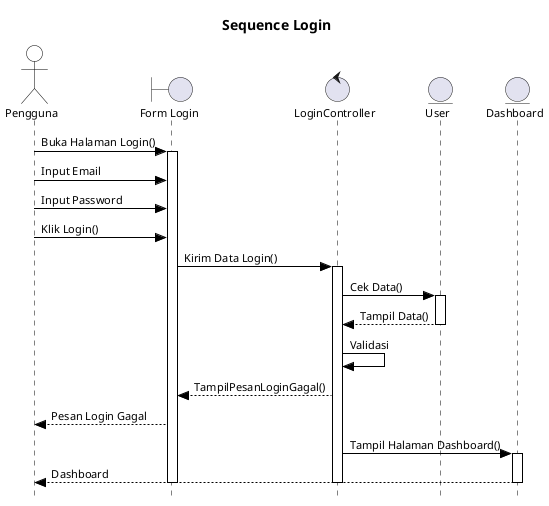

# Unit Unjuk Kerja Project BreadLab

## Identitas Project

* Nama Project: BreadLab Bakery
* Jenis Project: Sistem Informasi E-commerce Berbasis Web
* Framework: Laravel 10
* Arsitektur: MVC
* Database: MySQL, dikonfigurasi melalui `.env.example` dan `config/database.php`
* Fitur utama: produk, cart, checkout, pickup, local delivery, shipping, payment, order history, admin panel, chat, dashboard

## Ringkasan Unit

| No | Kode Unit | Judul Unit | Bukti Implementasi |
| -- | --------- | ---------- | ------------------ |
| 1 | J.620100.017.02 | Mengimplementasikan Pemrograman Terstruktur | Controller checkout, validasi, perulangan cart item |
| 2 | J.620100.017.02 | Menulis Kode Sesuai Guidelines dan Best Practice | Route, migration, MVC Laravel |
| 3 | J.620100.025.02 | Melakukan Debugging | Error handling RajaOngkir dan validasi Laravel |
| 4 | J.620100.023.02 | Membuat Dokumen Kode Program | Komentar kode, route, controller, model, view |
| 5 | J.620100.009.02 | Menggunakan Spesifikasi Program | Diagram PlantUML dan Draw.io pada folder dokumentasi |
| 6 | J.620100.018.02 | Mengimplementasikan Pemrograman Berorientasi Objek | Model Eloquent, inheritance, relationship |
| 7 | J.620100.019.002 | Menggunakan Library atau Komponen Pre-Existing | Hash, Auth, Storage, Http Client, DB, Chart.js, Leaflet |
| 8 | J.620100.021.02 | Menerapkan Akses Basis Data | Config database, migration, query Eloquent, seeder |
| 9 | J.62010.033.02 | Melaksanakan Pengujian Unit Program | Test bawaan Laravel |

## Unit 1 - Mengimplementasikan Pemrograman Terstruktur

Kode Unit: J.620100.017.02

### 1.1 Tampilan Data Menggunakan View

**File:** `app/Http/Controllers/CheckoutController.php`  
**Line:** 27-45

```php
public function index()
{
    // Checkout selalu dimulai dari cart aktif customer.
    $cart = $this->cart()->load('items.product.category');

    if ($cart->items->isEmpty()) {
        return redirect()->route('cart.index')->with('error', 'Keranjang masih kosong.');
    }

    return view('v_checkout.index', [
        'judul' => 'Checkout',
        'cart' => $cart,
        'subtotal' => $this->subtotal($cart),
        'totalWeight' => $this->totalWeight($cart),
        'localDeliveryFee' => $this->localDeliveryFee(),
        'couriers' => RajaOngkirService::COURIERS,
        'customerAddresses' => $this->customer()->addresses()->orderByDesc('is_default')->latest()->get(),
    ]);
}
```

**Penjelasan:** Controller mengambil cart aktif customer, memvalidasi cart kosong, lalu mengirim data lengkap ke view checkout.

### 1.2 Percabangan dan Array

**File:** `app/Http/Controllers/CheckoutController.php`  
**Line:** 267-321

```php
private function shipmentOption(array $validated, Cart $cart): array
{
    if ($validated['transaction_method'] === 'pickup') {
        // Pickup tidak membutuhkan ongkir, kurir, atau estimasi pengiriman.
        return [
            'shipping_cost' => 0,
            'courier' => null,
            'service' => null,
            'estimated_delivery' => null,
        ];
    }

    if ($validated['transaction_method'] === 'local_delivery') {
        // Local delivery memakai fee internal dari konfigurasi, bukan input frontend.
        return [
            'shipping_cost' => $this->localDeliveryFee(),
            'courier' => null,
            'service' => null,
            'estimated_delivery' => null,
        ];
    }

    if (config('services.rajaongkir.key') && (string) config('services.rajaongkir.mode', 'starter') !== 'komerce') {
        // Mode starter bisa divalidasi ulang ke RajaOngkirService sebelum order dibuat.
        $service = $this->rajaOngkir->findService(
            $validated['destination'],
            $validated['courier'],
            $validated['service'],
            $this->totalWeight($cart)
        );

        if (! $service) {
            throw new RuntimeException('Service RajaOngkir yang dipilih tidak valid.');
        }

        return [
            'shipping_cost' => (float) $service['cost'],
            'courier' => $service['courier'],
            'service' => $service['service'],
            'estimated_delivery' => $service['estimation'],
        ];
    }

    // Mode Komerce menggunakan service yang sudah dipilih di UI checkout.
    return [
        'shipping_cost' => (float) ($validated['shipping_cost'] ?? 0),
        'courier' => $validated['courier'] ?? null,
        'service' => $validated['service'] ?? null,
        'estimated_delivery' => $validated['estimated_delivery'] ?? null,
    ];
}
```

**Penjelasan:** Method ini menunjukkan percabangan, array, validasi service, dan penggunaan konfigurasi pada proses checkout.

### 1.3 Perulangan dan Operator Aritmatika

**File:** `app/Http/Controllers/CheckoutController.php`  
**Line:** 146-167

```php
foreach ($cart->items as $item) {
    // Lock produk mencegah dua checkout bersamaan memakai stok yang sama.
    $product = Product::whereKey($item->product_id)->lockForUpdate()->firstOrFail();

    if ((int) $item->quantity > (int) $product->stock) {
        throw new RuntimeException('Stok ' . $product->name . ' tidak mencukupi.');
    }

    $price = (float) ($item->price ?: $product->price);

    $order->items()->create([
        'product_id' => $product->id,
        'product_name' => $product->name,
        'quantity' => $item->quantity,
        'price' => $price,
        'subtotal' => $price * $item->quantity,
    ]);

    $product->decrement('stock', $item->quantity);
}
```

**Penjelasan:** Perulangan mengubah cart item menjadi order item. Operator aritmatika menghitung subtotal per item.

## Unit 2 - Menulis Kode Dengan Prinsip Guidelines dan Best Practice

Kode Unit: J.620100.017.02

### 2.1 Struktur MVC Laravel

**File:** `routes/web.php`  
**Line:** 319-335

```php
// Checkout mengubah cart menjadi order, payment, dan shipment.
Route::get('checkout', [CheckoutController::class, 'index'])->name('checkout.index');
Route::post('checkout', [CheckoutController::class, 'process'])->name('checkout.process');
// Endpoint AJAX RajaOngkir/Komerce untuk pilihan shipping di checkout dan address book.
Route::get('rajaongkir/provinces', [RajaOngkirController::class, 'provinces'])->name('rajaongkir.provinces');
Route::get('rajaongkir/cities', [RajaOngkirController::class, 'cities'])->name('rajaongkir.cities');
Route::get('rajaongkir/districts', [RajaOngkirController::class, 'districts'])->name('rajaongkir.districts');
Route::post('rajaongkir/cost', [RajaOngkirController::class, 'cost'])->name('rajaongkir.cost');
// Riwayat order customer dan chat per-order.
Route::get('orders', [OrderController::class, 'history'])->name('order.history');
Route::get('orders/{order}/chat', [ConversationController::class, 'show'])->name('chat.show');
Route::post('orders/{order}/chat/messages', [MessageController::class, 'send'])->name('chat.send');
Route::get('orders/{order}/chat/messages', [MessageController::class, 'fetch'])->name('chat.fetch');
Route::get('orders/{order}', [OrderController::class, 'detail'])->name('order.detail');
```

**Penjelasan:** Route menghubungkan URL ke controller, sedangkan controller memanggil model dan mengirim data ke view.

### 2.2 Migration

**File:** `database/migrations/2026_06_19_000000_create_breadlab_foundation_tables.php`  
**Line:** 71-105

```php
Schema::create('orders', function (Blueprint $table) {
    $table->id();
    $table->foreignId('customer_id')->constrained()->cascadeOnDelete();
    $table->string('order_number')->unique();
    $table->enum('status', [
        'pending',
        'waiting_payment',
        'paid',
        'processing',
        'ready_for_pickup',
        'delivering',
        'shipped',
        'completed',
        'cancelled',
    ])->default('pending');
    $table->enum('transaction_method', ['pickup', 'local_delivery', 'shipping'])->default('pickup');
    $table->enum('payment_method', ['cash', 'bank_transfer', 'midtrans'])->default('cash');
    $table->enum('payment_status', [
        'pending',
        'waiting_confirmation',
        'paid',
        'failed',
        'expired',
        'cancelled',
        'rejected',
    ])->default('pending');
    $table->decimal('subtotal', 12, 2)->default(0);
    $table->decimal('shipping_cost', 12, 2)->default(0);
    $table->unsignedInteger('total_weight')->default(0);
    $table->decimal('total_price', 12, 2)->default(0);
    $table->text('address')->nullable();
    $table->string('postal_code', 20)->nullable();
    $table->text('notes')->nullable();
    $table->timestamps();
});
```

**Penjelasan:** Migration memakai struktur tabel lengkap dan constraint Laravel.

## Unit 3 - Melakukan Debugging

Kode Unit: J.620100.025.02

### 3.1 Error Handling API

**File:** `app/Http/Controllers/RajaOngkirController.php`  
**Line:** 372-400

```php
private function rawPost(string $path, array $form = []): Response|JsonResponse
{
    $apiKey = config('services.rajaongkir.key');
    $baseUrl = $this->baseUrl();

    if (blank($apiKey)) {
        return $this->configurationError('RAJAONGKIR_API_KEY wajib diisi.');
    }

    if (blank($baseUrl)) {
        return $this->configurationError('RAJAONGKIR_BASE_URL wajib diisi.');
    }

    try {
        return Http::timeout(15)
            ->withHeaders([$this->keyHeader() => $apiKey])
            ->asForm()
            ->post($this->urlFor($path), $form);
    } catch (ConnectionException $exception) {
        return $this->apiError(0, 'Tidak bisa terhubung ke RajaOngkir. Periksa koneksi internet dan base URL.', [
            'exception' => $exception->getMessage(),
            'endpoint' => $this->urlFor($path),
        ], $this->urlFor($path));
    } catch (Throwable $exception) {
        return $this->apiError(0, 'Request RajaOngkir gagal diproses. Periksa konfigurasi SSL, base URL, dan koneksi.', [
            'exception' => $exception->getMessage(),
            'endpoint' => $this->urlFor($path),
        ], $this->urlFor($path));
    }
}
```

**Penjelasan:** Debugging dibuat aman dengan validasi konfigurasi, try catch, dan pesan error yang jelas.

## Unit 4 - Membuat Dokumen Kode Program

Kode Unit: J.620100.023.02

### 4.1 Komentar Kode

**File:** `app/Http/Controllers/CheckoutController.php`  
**Line:** 124-167

```php
// Cek stok awal memberi pesan cepat sebelum masuk transaction.
// Stok tetap dicek ulang dengan lockForUpdate saat order dibuat.
foreach ($cart->items as $item) {
    if ((int) $item->quantity > (int) $item->product->stock) {
        return redirect()->route('cart.index')
            ->with('error', 'Stok ' . $item->product->name . ' tidak mencukupi.');
    }
}
```

**Penjelasan:** Komentar menjelaskan alasan validasi stok dilakukan sebelum database transaction.

### 4.2 Dokumentasi Diagram

**File:** `docs/diagrams/unit-unjuk-kerja-style/02-sequence-login.puml`  
**Line:** 1-51



**Penjelasan:** Diagram PlantUML disiapkan sebagai dokumentasi alur sistem.

## Unit 5 - Menggunakan Spesifikasi Program

Kode Unit: J.620100.009.02

### 5.1 Daftar Diagram

Dokumentasi spesifikasi program tersedia pada folder berikut:

* `docs/diagrams/unit-unjuk-kerja-style/`
* `.codex/diagrams/unit-unjuk-kerja-style/`
* `.codex/diagrams/final-package/`

Diagram yang disiapkan meliputi ERD, LRS, Use Case, Activity, dan Sequence Diagram. File diagram disimpan sebagai source dokumentasi, bukan sebagai kode aplikasi.

## Unit 6 - Mengimplementasikan Pemrograman Berorientasi Objek

Kode Unit: J.620100.018.02

### 6.1 Class dan Encapsulation

**File:** `app/Models/Order.php`  
**Line:** 10-44

```php
class Order extends Model
{
    // Status operasional order; status pembayaran tetap dipisahkan di Payment.
    public const STATUSES = [
        'pending',
        'waiting_payment',
        'paid',
        'processing',
        'ready_for_pickup',
        'delivering',
        'shipped',
        'completed',
        'cancelled',
    ];

    protected $fillable = [
        'customer_id',
        'outlet_id',
        'cashier_shift_id',
        'cashier_id',
        'order_number',
        'order_channel',
        'status',
        'transaction_method',
        'service_type',
        'customer_name',
        'customer_phone',
        'table_number',
        'pickup_time',
        'order_source',
        'payment_method',
        'payment_status',
        'subtotal',
        'shipping_cost',
        'total_weight',
        'total_price',
        'address',
        'postal_code',
        'notes',
    ];
```

**Penjelasan:** Model menggunakan class, konstanta, dan `$fillable` untuk mengatur data yang boleh diisi.

### 6.2 Relationship Eloquent

**File:** `app/Models/Order.php`  
**Line:** 83-96

```php
public function payment()
{
    return $this->hasOne(Payment::class);
}

public function shipment()
{
    return $this->hasOne(Shipment::class);
}

public function conversation()
{
    return $this->hasOne(Conversation::class);
}
```

**Penjelasan:** Relasi Eloquent menghubungkan order dengan payment, shipment, dan conversation.

## Unit 7 - Menggunakan Library atau Komponen Pre-Existing

Kode Unit: J.620100.019.002

### 7.1 Storage dan DB Transaction

**File:** `app/Http/Controllers/PaymentController.php`  
**Line:** 56-101

```php
public function storeProof(Request $request, Order $order)
{
    $this->authorizeCustomerOrder($order);
    $order->load('payment');

    abort_unless($order->payment_method === 'bank_transfer', 404);

    if ($order->payment?->payment_status === 'paid') {
        return redirect()->route('payment.show', $order)->with('error', 'Pembayaran sudah terverifikasi.');
    }

    $validated = $request->validate([
        'payment_proof' => ['required', 'file', 'mimes:jpg,jpeg,png,webp,pdf', 'max:4096'],
    ]);

    // File disimpan di public disk agar bisa ditampilkan admin saat verifikasi.
    $path = $validated['payment_proof']->store('payment-proofs', 'public');

    DB::transaction(function () use ($order, $path) {
        if ($order->payment?->payment_proof) {
            Storage::disk('public')->delete($order->payment->payment_proof);
        }

        // Setelah upload, pembayaran menunggu konfirmasi admin.
        $order->payment()->updateOrCreate([
            'order_id' => $order->id,
        ], [
            'payment_method' => 'bank_transfer',
            'payment_status' => 'waiting_confirmation',
            'payment_proof' => $path,
            'paid_at' => null,
        ]);

        $order->update([
            'payment_status' => 'waiting_confirmation',
        ]);
    });

    return redirect()->route('payment.show', $order)->with('success', 'Bukti pembayaran berhasil diupload.');
}
```

**Penjelasan:** Controller memakai validasi Laravel, Storage, dan DB transaction untuk upload bukti pembayaran.

### 7.2 Http Client

**File:** `app/Http/Controllers/RajaOngkirController.php`  
**Line:** 386-389

```php
return Http::timeout(15)
    ->withHeaders([$this->keyHeader() => $apiKey])
    ->asForm()
    ->post($this->urlFor($path), $form);
```

**Penjelasan:** Http Client Laravel digunakan untuk request ke RajaOngkir/Komerce.

### 7.3 Chart.js

**File:** `resources/views/backend/v_dashboard/index.blade.php`  
**Line:** 146-189

```html
<script>
    const charts = @json($charts);
    const palette = ['#8B4513', '#D2691E', '#2962ff', '#198754', '#ffc107', '#dc3545', '#6f42c1', '#20c997', '#6c757d'];

    // Helper kecil agar konfigurasi Chart.js dashboard tidak berulang.
    function makeChart(id, type, labels, data, options = {}) {
        const element = document.getElementById(id);
        if (!element) {
            return;
        }

        new Chart(element, {
            type,
            data: {
                labels,
                datasets: [{
                    data,
                    label: options.label || '',
                    backgroundColor: type === 'line' ? 'rgba(139, 69, 19, .16)' : palette,
                    borderColor: '#8B4513',
                    borderWidth: 2,
                    tension: .35,
                    fill: type === 'line',
                }],
            },
            options: {
                responsive: true,
                maintainAspectRatio: false,
                plugins: {
                    legend: { display: type !== 'bar' && type !== 'line' },
                },
                scales: type === 'doughnut' ? {} : {
                    y: { beginAtZero: true },
                },
            },
        });
    }

    makeChart('orderStatusChart', 'doughnut', charts.orderStatus.labels, charts.orderStatus.data);
    makeChart('paymentStatusChart', 'doughnut', charts.paymentStatus.labels, charts.paymentStatus.data);
    makeChart('revenueTrendChart', 'line', charts.revenueTrend.labels, charts.revenueTrend.data, { label: 'Revenue' });
    makeChart('topProductChart', 'bar', charts.topProducts.labels, charts.topProducts.data, { label: 'Terjual' });
</script>
@endsection
```

**Penjelasan:** Dashboard admin memakai Chart.js untuk grafik status order, payment, revenue, dan top product.

## Unit 8 - Menerapkan Akses Basis Data

Kode Unit: J.620100.021.02

### 8.1 Konfigurasi Database

**File:** `config/database.php`  
**Line:** 18-20

```php
'default' => env('DB_CONNECTION', 'mysql'),
```

**Penjelasan:** Laravel membaca koneksi database dari environment.

### 8.2 Query Eloquent

**File:** `app/Http/Controllers/PaymentController.php`  
**Line:** 87-96

```php
public function index()
{
    $payments = Payment::with('order.customer.user')
        ->latest()
        ->paginate(15);

    return view('backend.v_payment.index', [
        'judul' => 'Pembayaran',
        'payments' => $payments,
    ]);
}
```

**Penjelasan:** Eloquent mengambil payment beserta relasi order, customer, dan user.

### 8.3 Seeder

**File:** `database/seeders/DatabaseSeeder.php`  
**Line:** 31-39

```php
$roles = [
    'super_admin' => ['Super Admin', 'Akses penuh ke seluruh sistem.'],
    'admin' => ['Admin', 'Mengelola setup dan konfigurasi operasional.'],
    'manager' => ['Manager', 'Monitoring dan laporan read-only.'],
    'staff_outlet' => ['Staff Outlet', 'Input operasional outlet sesuai akses outlet dan divisi.'],
    'cashier' => ['Cashier', 'Akses panel POS dan transaksi kasir.'],
    'customer' => ['Customer', 'Akses website customer.'],
];

foreach ($roles as $name => [$displayName, $description]) {
    Role::updateOrCreate(
        ['name' => $name],
        ['display_name' => $displayName, 'description' => $description]
    );
}
```

**File:** `database/seeders/DatabaseSeeder.php`  
**Line:** 166-172

```php
User::updateOrCreate(['email' => 'admin@admin.com'], [
    'name' => 'Super Administrator',
    'role' => 'super_admin',
    'status' => 'active',
    'phone' => '0812345678901',
    'password' => Hash::make('P@55word'),
]);
```

**File:** `database/seeders/DatabaseSeeder.php`  
**Line:** 196-214

```php
collect(['Brownies', 'Combro', 'Dawet', 'Mochi', 'Wingko'])->each(function (string $name) {
    Category::updateOrCreate(['slug' => Str::slug($name)], [
        'name' => $name,
        'status' => 'active',
    ]);
});

$brownies = Category::where('slug', 'brownies')->first();
$mochi = Category::where('slug', 'mochi')->first();

Product::updateOrCreate(['slug' => 'brownies-cokelat'], [
    'category_id' => $brownies?->id,
    'name' => 'Brownies Cokelat',
    'description' => 'Brownies lembut dengan rasa cokelat pekat.',
    'price' => 45000,
    'stock' => 20,
    'weight' => 500,
    'status' => 'published',
]);
```

**Penjelasan:** Seeder memakai `updateOrCreate` agar aman dijalankan berulang tanpa membuat data duplikat.

## Unit 9 - Melaksanakan Pengujian Unit Program

Kode Unit: J.62010.033.02

### 9.1 Bukti File Test

**File:** `tests/Feature/ExampleTest.php`  
**Line:** 8-17

```php
class ExampleTest extends TestCase
{
    public function test_the_application_returns_a_successful_response(): void
    {
        $response = $this->get('/');
        $response->assertRedirect(route('beranda'));
    }
}
```

**File:** `tests/Unit/ExampleTest.php`  
**Line:** 7-14

```php
class ExampleTest extends TestCase
{
    public function test_that_true_is_true(): void
    {
        $this->assertTrue(true);
    }
}
```

**Penjelasan:** Test memverifikasi redirect halaman utama dan assertion dasar PHPUnit.
